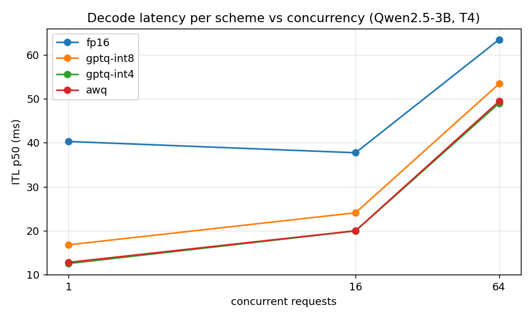

# quantlab

Same model, FP16 vs INT8 vs AWQ (and FP8 where supported): measured quality, latency and VRAM trade-offs for LLM serving.

Project 5 of 15 in [inference-infra-portfolio](https://github.com/NomanJafar/inference-infra-portfolio).

## What this builds

Serve the same model in FP16, INT8 and AWQ (FP8 where hardware allows) and benchmark quality, latency and VRAM side by side.

## Why it matters

Quantization decisions need measured trade-offs, not vibes.

## Status

Done. T4 results below; raw data in [`results/kaggle_run3/`](results/kaggle_run3/) (runs 1–2 failed on a dataset id and on `asyncio.run` inside Jupyter; their logs and post-mortems are in `results/kaggle_run1..2/`).

## What is in here

| Module | Purpose |
|---|---|
| `quantlab.evals` | Perplexity over an OpenAI-compatible endpoint via `prompt_logprobs`; GSM8K exact match with greedy generation and a `#### <number>` answer marker |
| `quantlab.report` | Answer extraction and scoring, the comparison table with deltas against FP16, Markdown rendering |
| `notebooks/kaggle_quantlab.ipynb` | For each of FP16, GPTQ-Int8, GPTQ-Int4, AWQ (official Qwen2.5-3B-Instruct checkpoints): launch vLLM, read weights and KV cache from the startup log, 200 WikiText-2 paragraphs for perplexity, 100 GSM8K problems, tokenbench sweep at 1, 16, 64 users |

## Results (Tesla T4, vLLM 0.31.0, Qwen2.5-3B-Instruct, Kaggle, 2026-10-11)

Fixed 256-token prompts and 128 output tokens for the latency sweep; `temperature 0` for both quality evals; vLLM read the quantization method from each checkpoint and selected `MarlinLinearKernel` for GPTQ-Int4 and AWQ.

| scheme | weights GiB | KV cache GiB | perplexity (Δ%) | GSM8K EM (Δpts) | TTFT p50 @1 | ITL p50 @1 (speedup) | ITL p50 @16 | out tok/s @64 |
|---|---|---|---|---|---|---|---|---|
| fp16 | 5.79 | 6.01 | 13.28 (0.0%) | 81% (0.0) | 52 ms | 40.3 ms (1.00x) | 37.7 ms | 962 |
| gptq-int8 | 3.27 | 8.51 | 13.28 (0.0%) | 77% (-4.0) | 31 ms | 16.8 ms (2.41x) | 24.1 ms | 1126 |
| gptq-int4 | 1.94 | 9.87 | 14.31 (7.8%) | 73% (-8.0) | 29 ms | 12.5 ms (3.23x) | 19.9 ms | 1225 |
| awq | 1.95 | 9.86 | 14.39 (8.4%) | 66% (-15.0) | 30 ms | 12.8 ms (3.16x) | 20.0 ms | 1218 |



### What the numbers say

1. **At one user, speedup tracks the weight-size ratio, which is the memory-bound prediction.** INT4 weights are 3.0x smaller than FP16 and decode 3.2x faster (12.5 vs 40.3 ms per token); INT8 is 1.8x smaller and 2.4x faster. Both FP16 and INT4 move weights at about 50% of the T4's 320 GB/s (154 and 167 GB/s), so the de-quantization in the Marlin kernel costs nothing visible at batch 1.
2. **The advantage fades with batch size, as predicted.** At 64 users INT4 gives +27% throughput (1,225 vs 962 tok/s) and ITL 49 vs 64 ms: decode is becoming compute-bound, the weight read is no longer the pacing item, and the de-quantization work is paid every step regardless.
3. **The memory win is bigger than the weight numbers suggest.** FP16 left 6.0 GiB of KV cache; INT4 left 9.9 GiB (+64%), which on this model is about 100k more cached tokens, or 25 more concurrent 4k-token requests. For a small GPU this is often the stronger argument.
4. **INT8 is free in quality.** Perplexity identical to two decimals (13.28), GSM8K 77% vs 81% with n = 100 (standard error ≈ 4.5 points, so inside noise). 2.4x single-stream speed and +42% cache for no measured cost.
5. **4-bit costs real accuracy on a 3B model, and the two 4-bit schemes are not equal here.** Perplexity rises 7.8% (GPTQ) and 8.4% (AWQ): similar. But GSM8K falls to 73% (GPTQ-Int4, borderline-significant) and 66% (AWQ, −15 points, well outside noise). Reasoning degrades before fluency does (CONCEPTS.md section 4), and perplexity alone would have called the two schemes a tie. Which checkpoint is better depends on its calibration, not just the algorithm; these are the official Qwen releases.
6. **Decision for an interactive workload on this card:** GPTQ-Int8 if accuracy matters (no measurable loss, 2.4x faster, +42% cache); GPTQ-Int4 if memory or latency dominates and an ~8-point GSM8K hit is acceptable; AWQ not with this checkpoint. For batch-heavy serving the choice matters far less (all within 27% at 64 users) and INT8's quality safety wins.

### What was not measured

FP8 (no T4 support); self-quantized checkpoints with controlled calibration; the KV cache in lower precision; GSM8K with enough problems to separate INT8 from FP16 (n = 100 cannot); larger models, where 4-bit loses less.

## Layout

```
CONCEPTS.md     the theory behind the project, written before the code
src/quantlab/   implementation
tests/          CPU-only tests, runnable on a laptop
notebooks/      GPU notebooks (Kaggle / Colab) that run the experiments and write results/
results/        measured numbers and plots
```

## Running

```bash
python -m venv .venv && source .venv/bin/activate
pip install -e ".[dev]"
pytest
```

GPU experiments run from `notebooks/`; each notebook clones this repo, installs it and writes its outputs to `results/`.

## Hardware notes

Developed against free-tier GPUs (Kaggle and Colab T4, 16 GB). Where a T4 limits what can be measured (no FP8, Turing-era kernels), the README says so rather than papering over it.

## License

MIT
